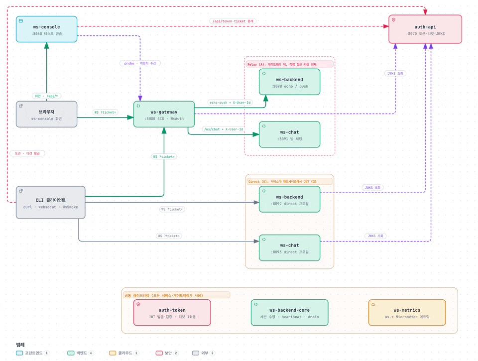

# Websocket Service Architecture (w. Spring Cloud Gateway)

Spring Cloud Gateway 뒤에서 **실사용 수준의 WebSocket 서비스**를 제공하는 아키텍처의 MVP이자 PoC다.
인증, 경로 라우팅, 세션 수명 관리, 무중단 배포(drain), 관측성처럼 실서비스에 필요한 요소를 갖추고 테스트로 검증해 두었다.
같은 구조의 서비스를 만들 때 이 소스를 참고 구현으로 쓸 수 있다.

함께, WebSocket을 게이트웨이로 중계(relay)할 때와 서비스에 직접 연결(direct)할 때의 비용 차이를 1 vCPU / 4 GB 파드에서 수치로 비교하는 PoC도 진행한다([PoC: 검증할 가설](#poc-검증할-가설)).

Kotlin, Spring Boot 4, WebFlux(Reactor Netty), Spring Cloud Gateway 5로 만들었다.

## 아키텍처

```
                        ┌──────────────┐  토큰 · 1회용 WS 티켓 발급, JWKS
                        │   auth-api   │◀──────────────────────────────┐
                        └──────────────┘                               │
                                                                       │
A. Relay   클라이언트 ──▶ ws-gateway (SCG) ──┬─ /ws/echo, /ws/push ──▶ ws-backend ─┤
                         · JWT/티켓 검증       ├─ /ws/public/push ────▶ ws-backend  │ (공통 런타임 ws-backend-core)
                         · 신원 헤더 주입      └─ /ws/chat ───────────▶ ws-chat ────┘

B. Direct  클라이언트 ──────────────────────────────────────────────▶ ws-backend / ws-chat
                                                         (핸드셰이크에서 JWT 직접 검증)
```

- **relay가 기본 구조다.** 게이트웨이가 인증을 끝내고 경로로 서비스를 고른다. 서비스는 게이트웨이가 넣은 신원 헤더만 신뢰한다.
- **서비스는 공통 런타임 위에 얹는다.** WebSocket 서비스는 `@WsEndpoint`를 붙인 핸들러와 메시지 처리 로직만 작성하고, 인증·heartbeat·만료·drain·메트릭은 `ws-backend-core`가 맡는다. echo/push(`ws-backend`)와 채팅(`ws-chat`) 두 서비스가 그 예다.
- **direct는 비교용 구성이다.** 같은 서비스를 `direct` 프로필로 띄우면 게이트웨이 없이 서비스가 JWT를 직접 검증한다.

### 아키텍처 다이어그램



- 인터랙티브 다이어그램(HTML): [`docs/archify/websocket-poc-architecture.html`](docs/archify/websocket-poc-architecture.html). 내려받아 브라우저로 연다. 데이 테마와 흐름 애니메이션(Live)으로 시작하고, 노드를 누르면 근거 소스 위치가 보인다.
- 흐름 애니메이션 원본(WebM, 약 6초): [`docs/archify/websocket-poc-architecture.webm`](docs/archify/websocket-poc-architecture.webm)
- 다이어그램 원본: [`docs/archify/websocket-poc-architecture.json`](docs/archify/websocket-poc-architecture.json)([archify](https://github.com/tt-a1i/archify) 입력)

구조가 바뀌면 JSON을 고친 뒤 다시 만든다(gifski 필요: `brew install gifski`).

```bash
archify finalize architecture docs/archify/websocket-poc-architecture.json docs/archify/websocket-poc-architecture.html --repo-root . --quality showcase --out-dir "$TMPDIR/archify-receipts"
rm docs/archify/*.delivery.json                                                   # 검사 영수증. 로컬 절대 경로가 들어 있다
node scripts/archify-defaults.mjs docs/archify/websocket-poc-architecture.html   # 초기 상태: 데이 테마 + Live
node scripts/archify-gif.mjs docs/archify/websocket-poc-architecture.html docs/archify/websocket-poc-architecture.gif
```

## 구현 완료 내용

| 영역 | 내용 |
|---|---|
| 인증 | 브라우저는 WebSocket 요청에 헤더를 넣을 수 없으므로, 수명 30초의 1회용 티켓을 `?ticket=`으로 받는다. `Authorization: Bearer`도 받는다. 실패는 **업그레이드 전에 HTTP 401**로 거절하고, relay에서는 upstream 연결도 열지 않는다 |
| 보안 | 게이트웨이는 클라이언트가 보낸 신원 헤더(`X-User-Id` 등)를 항상 지우고 인증된 값만 넣는다. 티켓은 재사용할 수 없고, 로그에는 `ticket=` 값이 남지 않는다 |
| 라우팅 | 경로별로 서비스를 고르고, 라우트 단위로 인증 여부를 선언한다(`filters: [WsAuth]`). 인증 없는 공개 엔드포인트도 둘 수 있다 |
| 세션 수명 | 서버 heartbeat(무응답 시 3008), access token 만료 시 종료(3000), 세션별 송신 큐와 느린 소비자 처리(가득 차면 버리고 집계), 프로토콜 예외는 그 세션만 1011 |
| 무중단 배포 | 종료 신호를 받으면 새 핸드셰이크는 503, 기존 세션은 20초 안에 지터를 두고 1001로 닫는다. 서비스와 게이트웨이 모두 같다 |
| close 코드 | RFC 6455 §7.4 범위만 쓴다. 이 범위의 코드만 SCG를 거쳐도 클라이언트에 그대로 전달된다 |
| 관측성 | `/actuator/prometheus`: 활성 세션, 핸드셰이크 결과(거절 사유 포함), 메시지 수, close 코드, event loop 지연, upstream 연결 결과, Reactor Netty·JVM 내장 메트릭 |
| 논블로킹 | event loop에서 블로킹 호출을 금지하고, 모든 테스트 JVM에서 BlockHound로 강제한다 |
| 개발 도구 | 브라우저 테스트 콘솔(ws-console): 시나리오별 화면과 프레임 타임라인, 재현용 curl, 거절 케이스 확인, 메트릭 모니터링 |

## 참고할 수 있는 구현

같은 구조를 만들 때 볼 만한 곳이다. 왜 그렇게 했는지는 괄호 안의 결정 번호로 [`docs/decisions.md`](docs/decisions.md)에서 찾는다.

| 하고 싶은 것 | 볼 곳 |
|---|---|
| SCG에서 WebSocket 업그레이드 전에 인증하기 | `ws-gateway` `WsAuthGatewayFilterFactory`, `GatewayEdgeFilter` (D20) |
| SCG 라우트를 YAML로 선언하고 서비스별로 나누기 | `ws-gateway` `application.yml` (D15, D18, D24) |
| SCG가 relay 중인 세션을 drain하기(SCG를 고치지 않고) | `ws-gateway` `relay/RelaySessionTracking`, `TrackingWebSocketService`, `GatewayDrainCoordinator` (D10, D24) |
| SCG의 close 코드 변환과 "101 뒤 1002" 이해하기 | [`docs/decisions.md`](docs/decisions.md) D13, D14 |
| WebFlux에서 경로 기반 WebSocket 엔드포인트 선언하기 | `ws-backend-core` `endpoint/WsEndpoint`, `WsEndpointHandlerMapping` (D16) |
| 핸드셰이크에서 JWT·티켓 검증하기(direct) | `ws-backend-core` `auth/WsHandshakeAuthFilter`, `HandshakeAuthenticator` |
| 세션 하나를 코루틴으로 관리하기(송신 큐, heartbeat, 만료, close) | `ws-backend-core` `session/ManagedWsHandler`, `ManagedSession` (D8, D9) |
| 새 WebSocket 서비스 만들기 | `ws-backend-service-chat` `ChatConfig`, `ChatProtocol` (D17, D18) |
| 1회용 티켓 발급·검증, JWKS 캐시와 키 회전 | `auth-token` `JwtIssuer`, `JwtVerifier`(`verifyHandshake`), `JwksKeySource`, `TicketReplayGuard` (D4, D5, D7, D22) |
| WebSocket 메트릭 설계(태그 개수 제한, event loop 지연) | `ws-metrics` `WsMeters`, `EventLoopLagProbe` (D27) |
| event loop 블로킹을 테스트로 잡기 | `build-logic`, `auth-token` testFixtures `WsPocBlockHoundIntegration` (D3, D6) |

## 참고할 때 주의할 점

MVP 단계라 실서비스로 옮길 때 채워야 할 것이 남아 있다. 자세한 목록은 [`docs/progress.md`](docs/progress.md)의 "후속 과제"에 있다.

- 티켓 재사용 방지와 채팅 방은 인스턴스 메모리에 있다. 여러 대로 늘리려면 공유 저장소(예: Redis)가 필요하다.
- 게이트웨이의 서비스 탐색은 정적 목록과 라운드로빈이다. K8s 디스커버리와 least-connections는 아직 없다.
- relay 모드 서비스는 게이트웨이가 넣은 헤더를 신뢰한다. 서비스로 가는 트래픽을 게이트웨이로만 제한해야 한다(NetworkPolicy 등).
- `/actuator`가 서비스 포트에 열려 있다. 외부에 노출하기 전에 management 포트를 분리하거나 막아야 한다.
- 토큰은 auth-api가 자체 서명한 JWT다. 실제 IdP 연동과 TLS 종단은 범위 밖이다.
- docker compose, K8s 매니페스트, 부하 테스트 스크립트는 아직 없다(M6, M7).

## 모듈

| 모듈 | 종류 | 설명 |
|---|---|---|
| `modules/auth-token` | 라이브러리 | JWT 발급·검증(RS256, JWKS), 1회용 티켓 재사용 방지, 게이트웨이 신원 헤더, 티켓 마스킹. Spring 비의존 |
| `modules/auth-api` | 앱 :8070 | `/auth/token`, `/auth/ws-ticket`, `/.well-known/jwks.json` |
| `modules/ws-metrics` | 라이브러리 | 서비스와 게이트웨이가 함께 쓰는 메트릭 정의 |
| `modules/ws-backend-core` | 라이브러리 | WebSocket 서비스 공통 런타임: `@WsEndpoint`, 핸드셰이크 인증, 세션 수명, drain, 메트릭 |
| `modules/ws-backend-service-default` | 앱 :8090 / :8092 | 서비스 `ws-backend`: `/ws/echo`, `/ws/push`, 익명 `/ws/public/push` |
| `modules/ws-backend-service-chat` | 앱 :8091 / :8093 | 서비스 `ws-chat`: `/ws/chat`(방 단위 채팅) |
| `modules/ws-gateway` | 앱 :8080 | Spring Cloud Gateway. 경로 라우팅과 라우트 단위 인증(`WsAuth`) |
| `modules/ws-console` | 앱 :8060 | 브라우저 테스트 콘솔과 메트릭 모니터링 |
| `build-logic` | Gradle | convention 플러그인(toolchain, ktlint, BlockHound) |

서비스 앱의 포트는 relay 모드(게이트웨이 헤더 신뢰) / `direct` 프로필(JWT 직접 검증) 순서다.

## 시작하기

필요한 것: JDK 25. 나머지는 Gradle wrapper가 받는다.

```bash
./gradlew build      # 컴파일 + ktlint + 전체 테스트(BlockHound 포함)
```

로컬 실행(터미널마다 하나씩):

```bash
./gradlew :modules:auth-api:bootRun                                   # :8070
./gradlew :modules:ws-backend-service-default:bootRun                 # :8090 (relay)
./gradlew :modules:ws-backend-service-chat:bootRun                    # :8091 (relay)
./gradlew :modules:ws-gateway:bootRun                                 # :8080
./gradlew :modules:ws-console:bootRun                                 # :8060 → http://localhost:8060

# direct 구조도 함께 보려면
./gradlew :modules:ws-backend-service-default:bootRun --args='--spring.profiles.active=direct'   # :8092
./gradlew :modules:ws-backend-service-chat:bootRun --args='--spring.profiles.active=direct'      # :8093
```

확인:

```bash
# JDK만으로 하는 E2E smoke (relay + direct)
java scripts/WsSmoke.java http://localhost:8070 ws://localhost:8080 ws://localhost:8092 ws://localhost:8093

# 메트릭
curl -s localhost:8080/actuator/prometheus | grep '^ws_'
```

브라우저로는 http://localhost:8060 의 콘솔에서 시나리오를 눌러 보고 "모니터링" 탭에서 메트릭을 본다.
websocat/curl로 직접 확인하는 방법은 [`docs/ws-cli-testing.md`](docs/ws-cli-testing.md)에 있다.

## PoC: 검증할 가설

relay와 direct의 비용 차이를 1 vCPU / 4 GB 파드에서 잰다. 자세한 내용과 실험 방법(E1–E5)은 [`docs/hypotheses.md`](docs/hypotheses.md)에 있다.

| # | 가설 |
|---|---|
| H1 | relay는 세션당 연결이 2개라 메모리·FD·conntrack이 약 2배 든다 |
| H2 | 1 vCPU / 4 GB 파드의 병목은 메모리가 아니라 CPU다 |
| H3 | 게이트웨이 → 백엔드를 단일 VIP로 연결하면 ephemeral port가 고갈되고, 파드 IP로 직접 라우팅하면 해소된다 |
| H4 | 장애나 배포 때 재연결 폭주의 병목은 핸드셰이크 CPU와 TIME_WAIT다 |
| H5 | 인증을 핸드셰이크로 분리해 직접 연결하면 중계 홉의 비용이 통째로 사라진다 |

## 현재 상태

| 마일스톤 | 내용 | 상태 |
|---|---|---|
| M0–M3 | 골격, 인증, ws-backend(direct), ws-gateway(relay) | 완료 |
| M4 | 공통 메트릭(`ws.*`, `/actuator/prometheus`) | 완료 |
| M5 | ws-console 모니터링 탭 | 완료 |
| M6 | Grafana 대시보드, docker compose, k6 스모크 | 예정 |
| M7 | K8s 배포(kustomize relay/direct) | 예정 |
| M8 | 실험 E1–E5와 결과 정리 | 예정 |

진행 기록은 [`docs/progress.md`](docs/progress.md)에 있다. 마일스톤 번호는 스펙과 다르며, 대응 관계는 그 문서 머리말에 있다.

## 문서

| 문서 | 내용 |
|---|---|
| [`docs/decisions.md`](docs/decisions.md) | 설계 결정과 그 이유, 스펙에서 벗어난 점(D1–D31) |
| [`docs/progress.md`](docs/progress.md) | 마일스톤별 진행과 검증 기록, 후속 과제 |
| [`docs/hypotheses.md`](docs/hypotheses.md) | 검증할 가설(H1–H5)과 실험 계획(E1–E5), 착수 당시 명세 |
| [`docs/ws-cli-testing.md`](docs/ws-cli-testing.md) | websocat/curl로 수동 확인하는 방법 |
| [`docs/metrics-proposals.md`](docs/metrics-proposals.md) | 추가하면 좋을 메트릭 제언 |
| [`CLAUDE.md`](CLAUDE.md) | 이 저장소에서 작업할 때의 규칙과 아키텍처 요약 |

## 기술 스택

JDK 25, Kotlin 2.3, Spring Boot 4.1, Spring Cloud 2025.1(Spring Cloud Gateway 5.0), WebFlux + Reactor Netty + Kotlin 코루틴, Jackson 3, nimbus-jose-jwt, Micrometer + Prometheus, JUnit 5 + BlockHound, Gradle Kotlin DSL(version catalog). Spring MVC는 쓰지 않는다.
